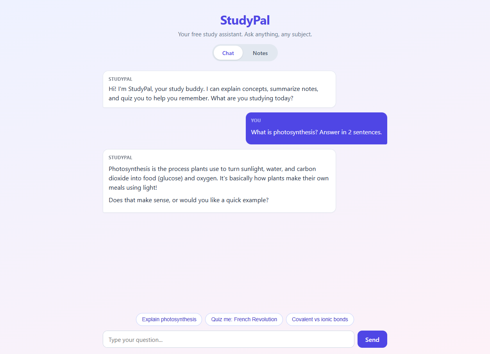
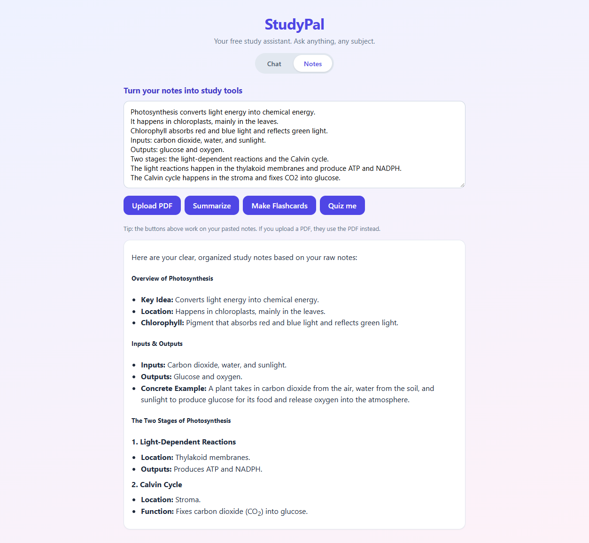

# StudyPal

[](https://studypal-pn3s.onrender.com/)
[](LICENSE)
[](package.json)

A free study assistant for college students. Chat with an AI tutor, or paste your notes to get a **summary**, **flashcards**, and a **practice quiz**.

**Live demo:** https://studypal-pn3s.onrender.com/

> The demo runs on Render's free tier, so the first load after a period of inactivity can take 30–60 seconds while the server wakes up.



<details>
<summary>Notes tab: paste notes, get a summary, flashcards, or a quiz</summary>



</details>

## Why it's free

- **Google Gemini API** has a generous free tier.
- The server is plain Node.js with **zero npm dependencies**.
- Hostable for free on Render, Vercel, or Railway.

## Features

- Chat tutor that explains concepts step by step
- Paste notes -> clean summary with headings and bullet points
- Paste notes -> flip-card flashcards
- Paste notes -> interactive quiz with instant feedback
- **Upload a PDF** (up to 20MB) -> summary, flashcards, and quiz straight from the document
- Rate limiting (30 requests/hour per IP, configurable) so the free quota stays safe

## Run it locally

1. Get a free API key: https://aistudio.google.com/apikey
2. Copy the example config and paste your key:

   ```bash
   copy .env.example .env
   # open .env and add: GEMINI_API_KEY=your-key-here
   ```

3. Start the server:

   ```bash
   node --env-file=.env server.js
   ```

4. Open http://localhost:3000

## How it works

```
Browser (public/)  --POST /api/chat or /api/notes-->  server.js  --Gemini API-->  AI
```

- `server.js` serves the static site and proxies AI requests to Gemini.
- Your API key never leaves the server (never put it in the frontend).
- Rate limiting (30 requests/hour per IP) keeps the free quota safe.

## API

| Endpoint | Body | Returns |
|----------|------|---------|
| `POST /api/chat` | `{ message, history }` | `{ reply, remaining }` |
| `POST /api/notes` | `{ text, action }` where action is `summary`, `flashcards`, or `quiz` | `{ result, remaining }` |

## Files

| File | Purpose |
|------|---------|
| `server.js` | HTTP server, Gemini proxy, rate limiting |
| `public/index.html` | Chat + Notes UI |
| `public/style.css` | Styling |
| `public/app.js` | Frontend logic (chat, flashcards, quiz) |
| `.env` | Your API key (never commit this) |
| `render.yaml` | Free hosting config for Render |

## Deploy for free (Render)

1. Push this folder to a GitHub repository.
2. Go to https://render.com and create a free account (Connect your GitHub).
3. New -> Web Service -> pick your repo -> Render auto-detects `render.yaml`.
4. Set the `GEMINI_API_KEY` secret in the dashboard (Dashboard -> your service -> Environment).
5. Deploy. You get a free `https://<service-name>.onrender.com` URL to share.

Note: Render free services "spin down" after ~15 minutes idle, so the first request after a break can take ~30 seconds to wake up.

## Roadmap

- [x] Chat with AI tutor
- [x] Paste notes -> summary, flashcards, quiz
- [x] File upload (PDF/notes)
- [ ] Account system (free tier via Supabase)
- [ ] Shareable study sets